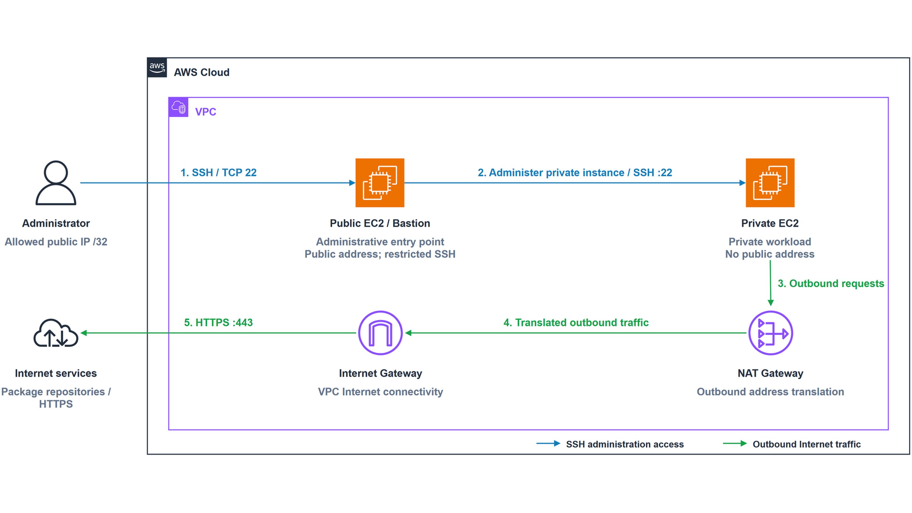

# Infrastructure as Code using Terraform/CloudFormation

## Objectives

1. Deploy AWS infrastructure independently using Terraform and AWS CloudFormation.
2. Organize infrastructure code into reusable modules and nested stacks.
3. Verify network configuration, SSH access and private-instance Internet connectivity.

## AWS Services to Deploy

### VPC

- **Subnets:** One public subnet and one private subnet.
- **Internet Gateway:** Attached to the VPC to provide Internet connectivity through the public route table.
- **NAT Gateway:** Located in the public subnet to provide outbound Internet access for the private instance.
- **Default Security Group:** Automatically created with the VPC and managed separately from the EC2 security groups.

### Route Tables

- **Public Route Table:** Routes Internet traffic through the Internet Gateway.
- **Private Route Table:** Routes outbound Internet traffic through the NAT Gateway.

### EC2 Instances

- **Public Instance:** Acts as a bastion host with a public IP address.
- **Private Instance:** Has no public IP address and is accessible through the bastion via SSH.

### Security Groups

- **Public EC2 Security Group:** Allows SSH on port 22 only from the administrator's public IPv4 address (/32).
- **Private EC2 Security Group:** Allows SSH on port 22 only from the public EC2 security group.

## Configuration

| Setting | Value |
| --- | --- |
| AWS Region | us-east-1 |
| Environment | lab |
| Terraform resource prefix | lab-tf |
| CloudFormation resource prefix | lab-cfn |

Terraform and CloudFormation deploy separate resources to avoid ownership conflicts.

## Architecture:

## Documentation

- [Architecture diagrams](docs/diagrams/)
- [Terraform deployment](terraform/README.md)
- [CloudFormation deployment](cloudformation/README.md)
- [Verification instructions](terraform/tests/README.md)

