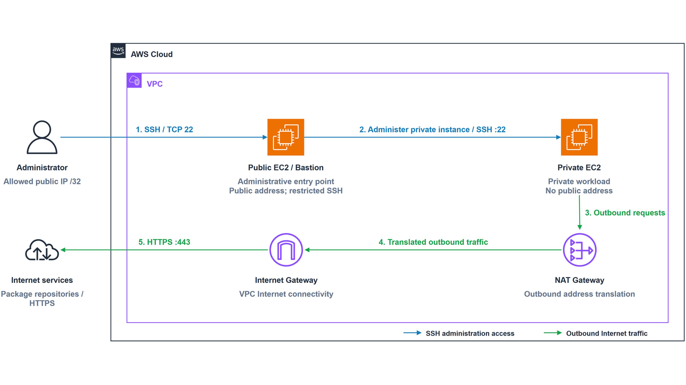

# Infrastructure Architecture

## Overview

Each deployment uses one Availability Zone in `us-east-1` and includes:

- One VPC with a public subnet and a private subnet.
- An Internet Gateway, a NAT Gateway with an Elastic IP, and two route tables.
- A public EC2 bastion and a private EC2 instance, each with its own security group.

The bastion provides SSH access to the private instance. The NAT Gateway lets the private instance access the Internet without a public IP. This single-AZ design is intended for the lab, not high availability.

## Architecture

**Blue:** SSH access through the bastion. **Green:** outbound Internet access through NAT and the Internet Gateway.

## Address Plan

| Setting | Terraform | CloudFormation |
| --- | --- | --- |
| Resource prefix | `lab-tf` | `lab-cfn` |
| VPC | `10.10.0.0/16` | `10.20.0.0/16` |
| Public subnet | `10.10.1.0/24` | `10.20.1.0/24` |
| Private subnet | `10.10.2.0/24` | `10.20.2.0/24` |

Choose an available AZ in `us-east-1`. The AMI and key pair must also belong to that region. Only the bastion receives a public IPv4 address.

## Terraform Structure

| Component | Manages |
| --- | --- |
| `environments/lab` | Provider, state backend and connections between modules. |
| `modules/network` | VPC, subnets, Internet Gateway, NAT/EIP and routing through the external VPC module. |
| `modules/security` | Public/private EC2 security groups and rules for the VPC default SG. |
| `modules/compute` | Bastion and private EC2 instances through external EC2 modules. |

## CloudFormation Structure

| Component | Manages |
| --- | --- |
| Parent stack `lab-cfn` | Creates and connects the three nested stacks. |
| Network stack | VPC, subnets, Internet Gateway, NAT/EIP and routing. |
| Security stack | Public/private EC2 security groups. |
| Compute stack | Bastion and private EC2 instances. |

Terraform and CloudFormation create separate resources. Each tool manages only its own deployment.

## Routing and SSH Access

| Subnet | Internet route |
| --- | --- |
| Public | `0.0.0.0/0` → Internet Gateway |
| Private | `0.0.0.0/0` → NAT Gateway in the public subnet |

Both route tables also have the VPC local route for internal communication. The Internet Gateway attaches to the VPC.

SSH connects to the bastion first, then to the private instance using **ProxyJump**. Keep the private key on the administrator's machine. NAT is used for outbound Internet traffic, not for SSH into the private instance.

## Security Groups

| Security group | Inbound | Outbound |
| --- | --- | --- |
| Public EC2 SG | TCP 22 from the administrator's public IPv4 `/32` only. | All IPv4 traffic. |
| Private EC2 SG | TCP 22 from the public EC2 SG only. | All IPv4 traffic. |

Update the administrator CIDR when the public IP changes. Outbound access is unrestricted to keep lab connectivity tests simple.

### Default Security Group

We manage the default SG to prevent accidental network access and keep its rules consistent with our code.

Terraform takes control of the existing default SG and removes its inbound and outbound rules. If an EC2 instance uses only this SG, new connections into and out of that instance are blocked. Access requires a separate SG with appropriate allow rules.

If someone manually adds a rule, the next Terraform plan detects the change; applying the configuration removes that rule again. The lab’s bastion and private instance use dedicated SGs, so this restriction does not affect their intended connections.

